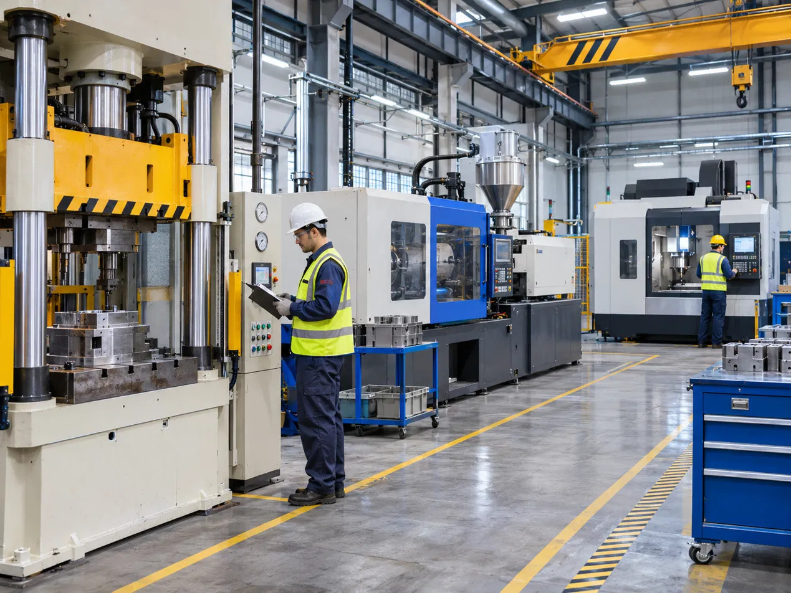
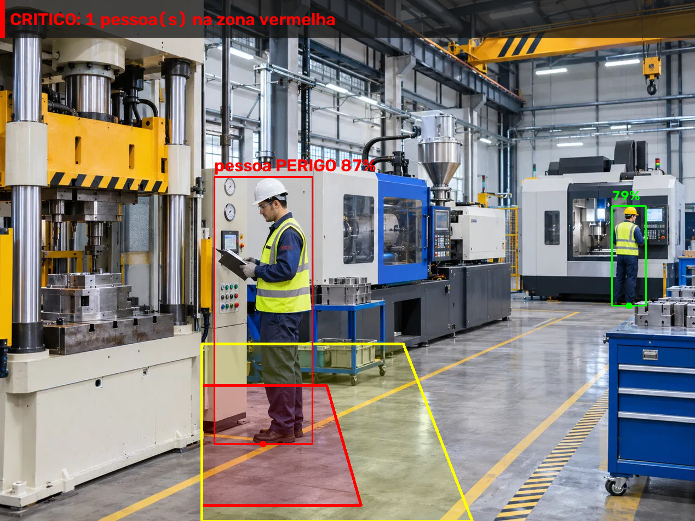
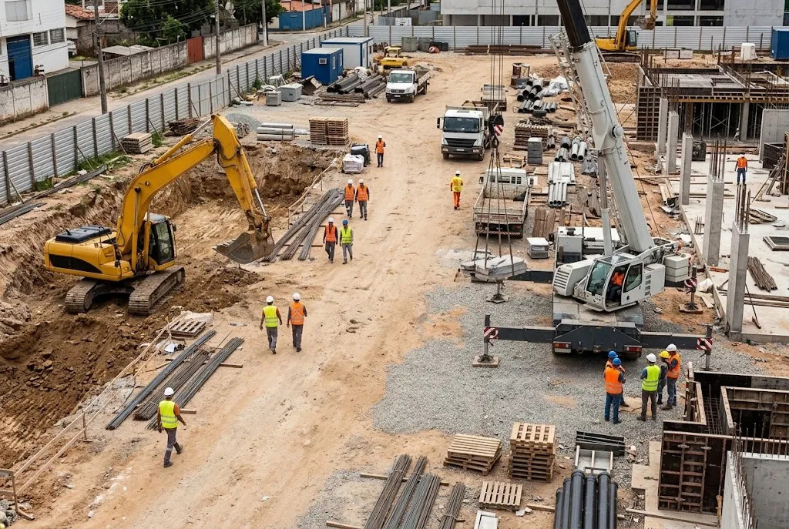
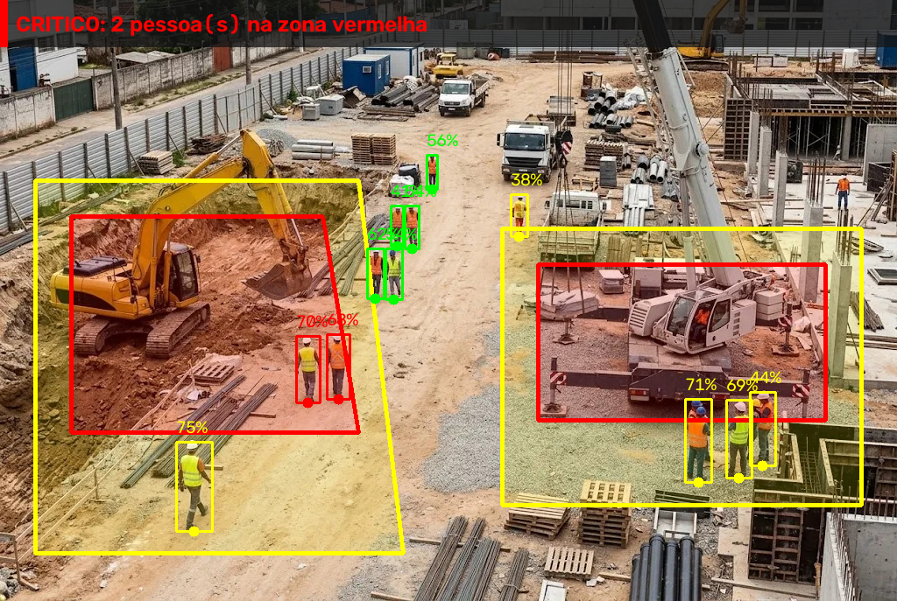
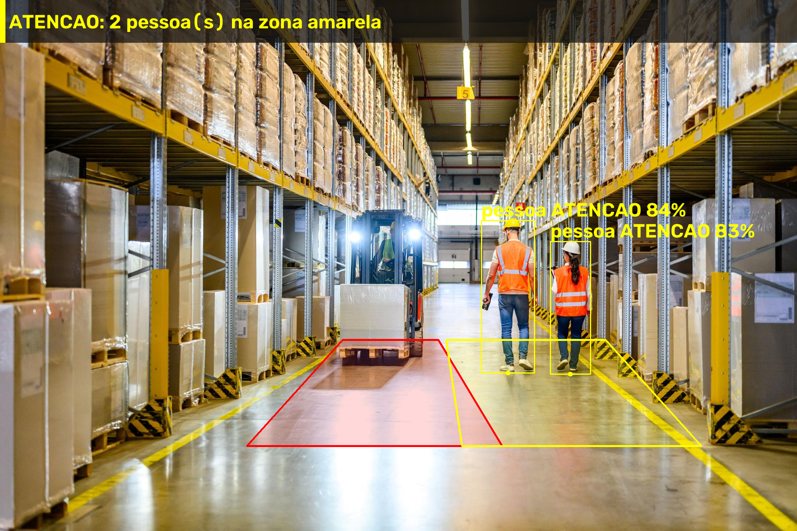
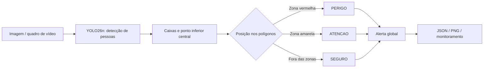

# Edge AI — Monitoramento de Risco em Zonas de Máquinas Pesadas

Protótipo de **visão computacional embarcada (Edge AI)** para detectar pessoas e sinalizar sua presença em regiões virtuais de risco de um ambiente industrial.

A aplicação utiliza **YOLO26n**, **Python**, **OpenCV** e **FastAPI**. A inferência ocorre **localmente em CPU**, sem solicitar inferência a um serviço em nuvem. A API é distribuída em Docker, com build multi-arquitetura **AMD64/ARM64** para possibilitar adaptação à **Raspberry Pi 5**.

> **Comportamento de risco tratado:** a presença ou invasão de pessoas em **zonas de exclusão ao redor de máquinas** (invasão de área restrita e posicionamento inadequado em relação ao equipamento), classificada em níveis de criticidade: `PERIGO` na zona vermelha, `ATENCAO` na zona amarela e `SEGURO` fora delas. Trata-se de um protótipo não certificado, concebido como **camada complementar** às proteções físicas de segurança, e não como substituto delas.

## 1. Demonstração visual

Cada cenário tem uma zona vermelha e uma zona amarela calibradas para a imagem de exemplo. As caixas indicam as pessoas detectadas, com rótulo de risco e confiança; o alerta global no topo resulta da posição dos pés de cada pessoa nas zonas.

Em pessoas pequenas na imagem (caixa com menos de 20% da altura da imagem), o rótulo mostra só a confiança, e a cor da caixa indica o risco: **verde** para seguro, **amarelo** para atenção e **vermelho** para perigo.

**Prensa hidráulica** (cenário `prensa`): o operador está na área de operação em frente à prensa (`PERIGO`) e outro trabalhador está fora das zonas (`SEGURO`). Alerta `CRITICO`.

| Imagem de entrada | Resultado da inferência |
|:---:|:---:|
|  |  |

**Canteiro de obras** (cenário `obra`): câmera elevada, com 12 pessoas detectadas e **uma zona vermelha e uma amarela para cada máquina**, a escavadeira e o guindaste. Duas pessoas estão no raio de giro da escavadeira (`PERIGO`). Cinco estão em faixas de aproximação (`ATENCAO`): uma junto à escavadeira e quatro junto ao guindaste. Outras cinco estão no caminho entre as máquinas, fora das zonas (`SEGURO`). Os três níveis aparecem na mesma cena. Alerta `CRITICO`.

| Imagem de entrada | Resultado da inferência |
|:---:|:---:|
|  |  |

**Exemplo adicional — depósito** (cenário `deposito`): duas pessoas na faixa de aproximação da empilhadeira (`ATENCAO`).

| Imagem de entrada | Resultado da inferência |
|:---:|:---:|
|  |  |

## 2. Como funciona



1. A imagem é recebida pela API ou capturada da webcam/vídeo.
2. O YOLO26n identifica objetos da classe COCO `person` (`classes=[0]`, confiança mínima de `0.35`, `device="cpu"`). A biblioteca Ultralytics realiza o pré-processamento e o pós-processamento próprios do detector.
3. Para cada pessoa, o sistema calcula o **centro inferior da bounding box**, como aproximação da posição dos pés no piso.
4. O ponto é comparado a polígonos de risco definidos em coordenadas normalizadas. Cada cor pode ter vários polígonos, um por máquina. A pessoa está em `PERIGO` se estiver em qualquer zona vermelha; caso contrário, em `ATENCAO` se estiver em qualquer zona amarela.
5. O alerta global segue a maior criticidade observada: `CRITICO` > `ATENCAO` > `NORMAL`.
6. A saída pode ser um JSON, uma imagem PNG anotada ou uma janela de monitoramento local.

### Etapas do pipeline

- **Pré-processamento:** decodificação do upload com `cv2.imdecode` (API) e redimensionamento opcional nos scripts de vídeo (`--largura`, preservando a proporção). O letterbox para 640 px e a normalização dos pixels são feitos pela Ultralytics dentro do `predict`.
- **Inferência:** YOLO26n na CPU, restrito à classe `person`. O modelo é carregado uma única vez e aquecido com uma inferência inicial, para que a primeira requisição não pague o custo de inicialização.
- **Pós-processamento:** filtro de confiança (`conf=0.35`), cálculo do ponto inferior central de cada caixa, classificação nas zonas, alerta global e anotação da imagem (polígonos, caixas, rótulo `pessoa <risco> <confiança>` e faixa de alerta).

**Risco por pessoa:** `SEGURO`, `ATENCAO` ou `PERIGO`. **Nível do alerta global:** `NORMAL`, `ATENCAO` ou `CRITICO`. Os alertas são **visuais e informativos**; não existe acionamento físico de sirene ou relé nesta versão.

### Cenários disponíveis

| Cenário | Aplicação | API HTTP | Monitoramento ao vivo |
|---|---|:---:|:---:|
| `padrao` | Exemplo genérico | Sim | Sim |
| `deposito` | Região próxima a empilhadeira | Sim | Sim |
| `corredor` | Faixa de circulação industrial | Sim | Sim |
| `prensa` | Zona de exclusão de prensa hidráulica | Sim | Sim |
| `obra` | Raio de giro de escavadeira e base de guindaste em canteiro de obras (duas zonas por cor) | Sim | Sim |
| `webcam` | Demonstração com terço esquerdo vermelho, central amarelo e direito fora das zonas | Não | Sim |

As zonas são parametrizadas para uma **posição de câmera fixa**. Se a câmera mudar de lugar ou enquadramento, é necessário recalibrar os polígonos em `app/zones.py`.

### Como configurar as zonas

Cada cenário em `CENARIOS` (`app/zones.py`) define as chaves `vermelha` e `amarela`, com coordenadas normalizadas entre 0 e 1 (x da esquerda para a direita, y de cima para baixo). Uma cor pode receber **um único polígono** ou **uma lista de polígonos**, um por máquina:

```python
"meu_cenario": {
    # Um polígono por cor
    "vermelha": [(0.30, 0.70), (0.50, 0.70), (0.50, 0.95), (0.30, 0.95)],
    # Ou vários polígonos por cor (uma zona por máquina)
    "amarela": [
        [(0.25, 0.60), (0.55, 0.60), (0.55, 1.00), (0.25, 1.00)],
        [(0.65, 0.40), (0.90, 0.40), (0.90, 0.80), (0.65, 0.80)]
    ]
},
```

Para disponibilizar um novo cenário na API, inclua o nome no `Literal` de `Cenario` em `app/main.py`.

## 3. Organização do repositório

```text
app/
  main.py                    # API FastAPI
  vision.py                  # Inferência e desenho das detecções
  zones.py                   # Polígonos e classificação geométrica
  alertas.py                 # Alerta global por criticidade
  monitorar_ao_vivo.py       # Webcam ou vídeo com janela OpenCV
  monitorar_video.py         # Vídeo anotado e relatório de desempenho
  criar_video_teste.py       # Geração de vídeo estático para teste
  testar_*.py                # Scripts auxiliares de demonstração
tests/                       # Testes automatizados
examples/imagens/            # Imagens de entrada: prensa.jpg, obra.jpg e test.jpg
docs/images/                 # Resultados anotados: prensa-, obra- e deposito-alerta.png
.github/workflows/docker-multiarch.yml
Dockerfile
docker-compose.yml
requirements.txt
yolo26n.pt                  # Pesos locais do modelo
```

## 4. Executar com Docker 

**Pré-requisitos:** Git e Docker Desktop (Windows) ou Docker Engine com Compose (Linux). Não é necessária uma Raspberry Pi física.

```powershell
git clone https://github.com/CainanJose/edge-ai-zonas-risco.git
cd edge-ai-zonas-risco
docker compose up --build -d
```

A primeira construção instala dependências e pode demorar. Depois, verifique o serviço:

```powershell
docker compose ps
curl.exe http://localhost:8000/health
```

Resposta esperada:

```json
{"status":"ok"}
```

Documentação interativa: **http://localhost:8000/docs**. A API utiliza a porta **8000**. Para acompanhar os logs ou encerrar:

```powershell
docker compose logs -f
docker compose down
```

O `docker-compose.yml` define `restart: always`. O container disponibiliza **a API HTTP em modo headless**; a janela gráfica de webcam descrita abaixo é uma execução local separada.

## 5. Testar os endpoints HTTP

Os comandos abaixo estão adaptados ao **PowerShell**. Execute na raiz do repositório, com o container em execução. No Windows, use `curl.exe` para chamar o executável curl em vez do alias do PowerShell. **No Linux/macOS**, use `curl` com os mesmos argumentos (e `mkdir -p outputs` no lugar de `New-Item`).

O arquivo é enviado no campo multipart `file`. O parâmetro opcional de query `cenario` aceita `padrao` (padrão), `deposito`, `corredor`, `prensa` ou `obra`.

### 5.1. JSON — `POST /infer/json`

```powershell
curl.exe -X POST "http://localhost:8000/infer/json?cenario=deposito" -F "file=@examples/imagens/test.jpg"
```

A resposta contém cenário, modelo, dimensões, número de pessoas, contagens, tempo de inferência, alerta global e uma lista de detecções (classe, confiança, caixa, ponto de referência e risco).

**Resposta real** para `examples/imagens/test.jpg` (2048 × 1366 px) no cenário `deposito`, obtida em 06/11/2026 no ambiente descrito na seção 9:

```json
{
  "cenario": "deposito",
  "modelo": "yolo26n.pt",
  "largura": 2048,
  "altura": 1366,
  "total_pessoas": 2,
  "contagem": {"SEGURO": 0, "ATENCAO": 2, "PERIGO": 0},
  "tempo_inferencia_ms": 109.42,
  "alerta": {
    "ativo": true,
    "nivel": "ATENCAO",
    "mensagem": "2 pessoa(s) na zona amarela",
    "resposta": "AVISO_VISUAL"
  },
  "deteccoes": [
    {
      "classe": "person",
      "confianca": 0.8366,
      "bbox": [1237, 567, 1373, 959],
      "ponto_referencia": [1305, 959],
      "risco": "ATENCAO"
    },
    {
      "classe": "person",
      "confianca": 0.8319,
      "bbox": [1414, 621, 1517, 962],
      "ponto_referencia": [1465, 962],
      "risco": "ATENCAO"
    }
  ]
}
```

**Cenário `prensa`**, com alerta crítico:

```powershell
curl.exe -X POST "http://localhost:8000/infer/json?cenario=prensa" -F "file=@examples/imagens/prensa.jpg"
```

Resposta real para `examples/imagens/prensa.jpg` (1269 × 952 px), obtida em 06/11/2026:

```json
{
  "cenario": "prensa",
  "modelo": "yolo26n.pt",
  "largura": 1269,
  "altura": 952,
  "total_pessoas": 2,
  "contagem": {"SEGURO": 1, "ATENCAO": 0, "PERIGO": 1},
  "tempo_inferencia_ms": 97.2,
  "alerta": {
    "ativo": true,
    "nivel": "CRITICO",
    "mensagem": "1 pessoa(s) na zona vermelha",
    "resposta": "ALERTA_VISUAL_CRITICO"
  },
  "deteccoes": [
    {
      "classe": "person",
      "confianca": 0.8664,
      "bbox": [391, 323, 570, 811],
      "ponto_referencia": [480, 811],
      "risco": "PERIGO"
    },
    {
      "classe": "person",
      "confianca": 0.7944,
      "bbox": [1117, 376, 1179, 558],
      "ponto_referencia": [1148, 558],
      "risco": "SEGURO"
    }
  ]
}
```

As detecções e a classificação são determinísticas para a mesma imagem e o mesmo cenário. O `tempo_inferencia_ms` varia conforme o hardware e a carga do sistema a cada chamada.

### 5.2. PNG anotado — `POST /infer/image`

```powershell
New-Item -ItemType Directory -Force outputs | Out-Null
curl.exe -X POST "http://localhost:8000/infer/image?cenario=deposito" -F "file=@examples/imagens/test.jpg" --output "outputs/resultado.png"
curl.exe -X POST "http://localhost:8000/infer/image?cenario=prensa" -F "file=@examples/imagens/prensa.jpg" --output "outputs/prensa.png"
curl.exe -X POST "http://localhost:8000/infer/image?cenario=obra" -F "file=@examples/imagens/obra.jpg" --output "outputs/obra.png"
```

A resposta tem `Content-Type: image/png`. Abra os arquivos gerados em `outputs/` para visualizar os polígonos, as caixas delimitadoras, o rótulo de cada pessoa (classe, risco e confiança, por exemplo `pessoa ATENCAO 84%`) e a faixa de alerta. O tamanho do texto acompanha a largura da imagem, para continuar legível em fotos de alta resolução.

**Validação de entradas:** arquivo vazio ou não decodificável retorna HTTP `400`; um cenário desconhecido retorna `422`.

## 6. Demonstração técnica

A demonstração técnica apresenta o funcionamento dos endpoints HTTP com a aplicação executando em Docker.. O roteiro previsto é:

1. Subir o serviço com `docker compose up --build -d` e mostrar `docker compose ps` (política `restart: always`).
2. Consultar `GET /health`.
3. Enviar `examples/imagens/prensa.jpg` para `POST /infer/json?cenario=prensa` e comentar o JSON (pessoas, confiança, risco, alerta `CRITICO` e tempo de inferência).
4. Enviar a mesma imagem para `POST /infer/image?cenario=prensa` e abrir o PNG anotado.
5. Repetir o endpoint PNG com `examples/imagens/obra.jpg` e `cenario=obra`, para mostrar os três níveis de risco na mesma cena.
6. Opcionalmente, mostrar a documentação interativa em `/docs`.


O monitoramento por webcam (seção 7) é uma demonstração complementar e não substitui a apresentação dos endpoints em Docker.

## 7. Executar localmente e usar webcam

Para a demonstração com janela gráfica do OpenCV, execute **fora do container**. Os comandos a seguir utilizam Windows PowerShell; rode-os na raiz do repositório:

```powershell
py -3 -m venv .venv
.\.venv\Scripts\Activate.ps1
python -m pip install -r requirements.txt
```

Os pesos `yolo26n.pt` estão no repositório; por isso, a execução deve partir da raiz do projeto.

Para iniciar a API localmente, caso prefira não usar Docker:

```powershell
python -m uvicorn app.main:app --host 127.0.0.1 --port 8000
```

Para monitorar a câmera integrada ou USB (os índices podem variar conforme o dispositivo):

```powershell
# Normalmente, camera integrada
python -m app.monitorar_ao_vivo --fonte 0 --cenario webcam --largura 640

# Normalmente, webcam USB externa
python -m app.monitorar_ao_vivo --fonte 1 --cenario webcam --largura 640
```

Pressione **Q** ou **Esc** na janela para encerrar. No Windows, a aplicação tenta os backends Media Foundation (`CAP_MSMF`), DirectShow (`CAP_DSHOW`) e automático (`CAP_ANY`), nessa ordem, e só aceita a câmera se conseguir ler um quadro. O rodapé da janela mostra o FPS efetivo, o tempo de processamento do quadro e o número de pessoas.

O mesmo script aceita um arquivo de vídeo em `--fonte` (com `--repetir` para reprodução em laço). Nesse modo, a exibição é sincronizada com o FPS original do vídeo; por isso, para medir desempenho, utilize o `monitorar_video.py`, descrito a seguir.

### Processar um vídeo de teste

O script abaixo cria um MP4 de **30 quadros repetidos da imagem de exemplo**. Ele serve para exercitar o fluxo e medir processamento, **não para avaliar movimentação real entre zonas**.

```powershell
python -m app.criar_video_teste
python -m app.monitorar_video --fonte examples/videos/teste_estatico.mp4 --cenario deposito --saida outputs/monitoramento_teste.mp4 --largura 640 --intervalo 1 --max-quadros 30
```

Os resultados são gravados em `outputs/monitoramento_teste.mp4` e `outputs/monitoramento_teste.json`. A pasta `outputs/` contém artefatos gerados localmente e não é versionada.

## 8. Escolha do modelo

Foi selecionado o **Ultralytics YOLO26n**, variante *nano* da família YOLO26, pré-treinada no conjunto COCO. O COCO já inclui a classe `person`, que é a única necessária para o problema; por isso, o modelo é usado **sem treinamento adicional**, filtrando apenas essa classe (`classes=[0]`).

**Por que a variante nano:** o problema exige localizar pessoas em uma cena, não distinguir categorias finas de objetos. Nesse contexto, o fator limitante em um dispositivo de borda é o custo computacional por quadro. O YOLO26n é a variante mais compacta da família: tem cerca de 4 vezes menos parâmetros que o YOLO26s e 8 vezes menos que o YOLO26m, com a menor latência de referência em CPU. Em troca, apresenta o menor mAP da família. Para um protótipo que roda em CPU, sem GPU dedicada, e que visa adaptação à Raspberry Pi 5, esse é o compromisso mais adequado entre custo computacional e capacidade de detecção.

**Referência oficial da Ultralytics** (detecção no COCO val2017, entrada de 640 px):

| Modelo | Parâmetros (M) | FLOPs (B) | mAP50-95 | Latência CPU ONNX (ms) |
|---|---:|---:|---:|---:|
| **YOLO26n** | **2,4** | **5,5** | **40,9** | **38,9 ± 0,7** |
| YOLO26s | 9,5 | 20,9 | 48,6 | 87,2 ± 0,9 |
| YOLO26m | 20,4 | 68,4 | 53,1 | 220,0 ± 1,4 |

Fonte: [Ultralytics — YOLO26](https://docs.ultralytics.com/models/yolo26/), consultada em 06/11/2026. Segundo a documentação, as latências foram medidas em formato ONNX, em uma CPU Intel Xeon de 2,00 GHz, com a cabeça sem NMS (`nms=False`).

Esses valores são **referências do fabricante**, obtidas em outro hardware e em formato ONNX. **Não são medições deste projeto**, que executa os pesos PyTorch (`.pt`) diretamente (ver seção 9). O mAP no COCO também não comprova a precisão do modelo em cenas industriais.

**Inferência sem NMS:** a arquitetura YOLO26 oferece um modo de inferência ponta a ponta, sem a etapa de supressão de não máximos (NMS), o que simplifica o pós-processamento em dispositivos de borda. Este projeto usa a chamada padrão `predict` da biblioteca Ultralytics e **não mediu** separadamente o ganho desse modo.

**Limiar de confiança:** o valor `0.35` é um ponto de partida do protótipo e **não foi calibrado experimentalmente**. Não foram medidos mAP, precisão ou recall em um conjunto industrial rotulado. A confiança retornada para cada detecção não equivale à acurácia global do modelo.

## 9. Desempenho e viabilidade em CPU

### Resultado medido

**Ambiente de medição (06/11/2026):**

| Item | Valor |
|---|---|
| Processador | 13th Gen Intel Core i5-13420H (8 núcleos, 12 threads) |
| Memória RAM | 8 GB (7,7 GiB visíveis ao sistema) |
| Sistema operacional | Windows 11 Home (build 26200), execução fora do container |
| Python / Ultralytics / PyTorch / OpenCV | 3.14.3 / 8.4.202 / 2.15.0+cpu / 5.0.0 |
| Aceleração | Nenhuma: inferência PyTorch somente em CPU, sem GPU |

Dados coletados com:

```powershell
Get-CimInstance Win32_Processor | Select-Object Name
Get-CimInstance Win32_ComputerSystem | Select-Object TotalPhysicalMemory
```

**Procedimento:** `monitorar_video.py` com o vídeo de teste de 30 quadros (640 × 426 px) derivado de `test.jpg`, sempre com 2 pessoas e alerta `ATENCAO` em todos os quadros (comandos na seção 7). O teste foi executado cinco vezes, com os mesmos parâmetros.

**Condições controladas:** notebook ligado ao carregador, Windows no modo de energia "Melhor desempenho" e terminal em primeiro plano.

| Execução | FPS efetivo | Tempo médio por quadro (ms) |
|---:|---:|---:|
| 1 | 29,51 | 31,96 |
| 2 | 18,25 | 52,14 |
| 3 | 26,41 | 35,69 |
| 4 | 24,91 | 37,74 |
| 5 | 21,83 | 43,55 |

**Resultado principal (mediana das 5 execuções): 24,91 FPS e 37,74 ms por quadro.** A faixa observada foi de **18,25 a 29,51 FPS** (31,96 a 52,14 ms por quadro).

Medições anteriores no mesmo notebook, feitas sem controlar o modo de energia, variaram entre 3,6 e 17,4 FPS. Essa diferença mostra que o desempenho depende fortemente da configuração de energia e do agendamento das threads entre os núcleos de desempenho e de eficiência dessa CPU.

O modelo é aquecido ao ser carregado (seção 2), de modo que essas médias **não incluem** o custo de inicialização.

**Estes números são do notebook. Não são medições na Raspberry Pi 5.**

### O que cada métrica representa

| Métrica | Onde aparece | O que mede |
|---|---|---|
| Tempo de inferência do YOLO | `tempo_inferencia_ms` na resposta da API | Apenas a chamada `predict` do YOLO26n (pré-processamento, rede neural e pós-processamento internos da Ultralytics) |
| Tempo de processamento por quadro | `latencia_media_ms` no relatório do vídeo | A função `analisar_imagem` completa: inferência, classificação nas zonas e desenho da imagem anotada |
| FPS efetivo | `fps_processamento` no relatório do vídeo | Quadros processados divididos pelo tempo total, incluindo também leitura do vídeo e gravação do MP4 |

Nenhuma dessas métricas mede a latência completa entre a captura da câmera e a exibição do alerta. O `monitorar_video.py` processa os quadros sem espera artificial, por isso é o script indicado para benchmark.

É um ensaio curto, com um único quadro repetido. A contagem de alertas é **por quadro**, não por incidentes distintos.

### Latência aceitável para o caso de uso

Uma pessoa caminhando se desloca a cerca de **1,4 m/s**. A distância percorrida entre duas análises consecutivas é a velocidade dividida pelo FPS efetivo:

- Mediana: 1,4 m/s ÷ 24,91 FPS ≈ 0,056 m, ou seja, **cerca de 5,6 cm** entre análises.
- Faixa: de 1,4 ÷ 29,51 ≈ **4,7 cm** a 1,4 ÷ 18,25 ≈ **7,7 cm**.

Mesmo na execução mais lenta, o deslocamento entre análises é pequeno em relação a zonas de alguns metros ao redor de uma empilhadeira ou máquina. Isso é suficiente para um **alerta visual de presença**: a pessoa é sinalizada logo depois de entrar na zona.

**Não é suficiente para uma parada de emergência.** A proteção de pessoas contra o movimento de máquinas exige dispositivos de segurança certificados, como cortinas de luz ou scanners a laser, integrados a sistemas de comando projetados conforme a NR-12 e a ISO 13849. O sistema proposto é, portanto, um **alerta complementar**, e não um intertravamento de segurança.

### Viabilidade

O pipeline completo (detecção, classificação nas zonas, alerta e anotação) funciona com **processamento local em CPU**, sem GPU e sem serviço em nuvem, com mediana de 24,91 quadros por segundo em 640 px neste notebook, nas condições de energia descritas acima. Essa taxa é adequada para um **monitoramento demonstrativo** de presença em zonas.

O resultado **não permite garantir** um tempo de resposta adequado para aplicações industriais de segurança. Isso exigiria requisitos de tempo de reação definidos para o processo, medições no hardware final e validação em campo. Latência e taxa de quadros variam conforme o processador, a resolução, o modelo, o formato de execução (PyTorch, ONNX, NCNN) e a carga do sistema.

Para repetir o experimento, use os comandos da seção 7, registre CPU, RAM, sistema operacional e versões das bibliotecas, e faça várias execuções após o aquecimento.

## 10. Docker multi-arquitetura e Raspberry Pi 5

O workflow [Docker Multi-Arquitetura](.github/workflows/docker-multiarch.yml) utiliza QEMU e Docker Buildx para construir e publicar a imagem em `linux/amd64` e `linux/arm64` no GitHub Container Registry (GHCR):

```text
ghcr.io/cainanjose/edge-ai-zonas-risco:latest
```

O Dockerfile escolhe o PyTorch conforme a arquitetura: no AMD64, instala a versão somente CPU (índice `download.pytorch.org/whl/cpu`, sem as bibliotecas CUDA); no ARM64, usa as wheels padrão do PyPI. Os pesos `yolo26n.pt` são copiados para a imagem, então o container não depende de download do modelo em tempo de execução.

**Evidência do build:** [GitHub Actions — execução #3 do workflow "Docker Multi-Arquitetura"](https://github.com/CainanJose/edge-ai-zonas-risco/actions/runs/42303193722/job/128185901208), concluída com sucesso em 06/11/2026 (commit `0ec86ed`). A última etapa do workflow executa `docker buildx imagetools inspect` para listar as plataformas publicadas. Para consultar o manifesto (requer acesso ao pacote no GHCR):

```bash
docker buildx imagetools inspect ghcr.io/cainanjose/edge-ai-zonas-risco:latest
```

**Build multi-arquitetura local** (reproduzível sem o GitHub Actions; requer Docker com Buildx e emulação QEMU, já incluídos no Docker Desktop):

```bash
docker buildx create --use
docker buildx build --platform linux/amd64,linux/arm64 -t edge-ai-zonas-risco:multiarch .
```

Sem `--push` (envio a um registry) ou `--load`, o resultado multiplataforma fica apenas no cache do Buildx. Ele serve para comprovar que a imagem é construída para as duas arquiteturas, mas não aparece em `docker images`. O build ARM64 por emulação é sensivelmente mais lento que o nativo.

### Estado da validação

| Etapa | Situação |
|---|---|
| Build e publicação da imagem `linux/amd64` e `linux/arm64` | Realizado no GitHub Actions |
| Execução do container e dos endpoints em AMD64 | Realizada localmente com Docker |
| Execução do container ARM64 | Não realizada |
| Inferência e medição de desempenho na Raspberry Pi 5 | Não realizada |

O build ARM64 bem-sucedido mostra que a imagem pode ser construída para a arquitetura da Raspberry Pi 5. Ele não substitui um teste de execução nem uma medição de FPS na placa.

### Adaptações para Raspberry Pi 5

- **Sistema e imagem:** usar Raspberry Pi OS 64 bits (ARM64) com Docker. O Docker seleciona automaticamente a variante `linux/arm64` da imagem.
- **Inferência em CPU:** a Raspberry Pi 5 não possui GPU compatível com a aceleração deste pipeline PyTorch. A inferência ocorre nos núcleos ARM64 da CPU, e por isso o desempenho esperado é inferior ao de um notebook.
- **Ajustes sem alterar a arquitetura:** reduzir a resolução de entrada (`--largura`) e processar um a cada N quadros (`--intervalo`) nos scripts de monitoramento.
- **Otimizações futuras:** exportar o modelo para **NCNN** (formato recomendado no guia da Ultralytics para Raspberry Pi) ou **ONNX** e reduzir o `imgsz` do modelo. Essas otimizações **não foram implementadas nem medidas** neste projeto.
- **Aceleradores externos:** módulos de NPU podem ser avaliados em uma evolução futura. Eles exigem hardware e runtime específicos e não são necessários para o funcionamento atual.
- **Operação:** usar fonte de alimentação adequada, dissipação de calor e câmera CSI ou USB compatível; monitorar temperatura, uso de CPU e memória.

### Estimativa por referência técnica

O guia oficial da Ultralytics para Raspberry Pi publica a latência do **YOLO26n na Raspberry Pi 5** (Ultralytics 8.4.108, precisão FP32, entrada de 640 px). Segundo o guia, esses tempos **não incluem** pré e pós-processamento:

| Formato | Inferência (ms/imagem) | FPS equivalente (só inferência) |
|---|---:|---:|
| PyTorch | 299,09 | ≈ 3,3 |
| ONNX | 125,99 | ≈ 7,9 |
| NCNN | 67,03 | ≈ 14,9 |

Fonte: [Ultralytics — guia para Raspberry Pi](https://docs.ultralytics.com/guides/raspberry-pi/), consultada em 06/11/2026. A coluna de FPS foi calculada aqui como 1000 ÷ ms.

Como este projeto executa os pesos em PyTorch, a estimativa para a Raspberry Pi 5 é da ordem de **3 FPS apenas de inferência**, com valor efetivo um pouco menor depois de somar decodificação, classificação e anotação. Exportar o modelo para **NCNN** é a otimização mais indicada, com redução de cerca de 4,5 vezes no tempo de inferência segundo a mesma referência. Esses valores são **estimativas por referência externa, não medições deste projeto na placa**.

**Procedimento proposto para validação na placa:** em Raspberry Pi OS 64 bits, clonar o repositório e executar `docker compose up --build -d` (ou baixar a imagem do GHCR). Em seguida, verificar `/health`, testar `/infer/json` e `/infer/image` com `test.jpg` e medir latência, FPS e uso de recursos (`docker stats`) em várias execuções após o aquecimento.

## 11. Testes

A suíte cobre os endpoints da API (incluindo inferência real com o modelo), a classificação geométrica nas zonas e as regras de alerta. Em execução local em 06/11/2026, **os 12 testes passaram**.

```powershell
python -m pip install pytest httpx
python -m pytest -q
```

Os testes validam contratos e regras principais, mas não são uma avaliação estatística de precisão do modelo em ambiente industrial.

## 12. Uso em aula

Em um curso presencial de IA aplicada, o repositório serve como laboratório prático. Os alunos:

1. Sobem o container e testam os endpoints pelo Swagger (`/docs`) ou com `curl`.
2. Ajustam os polígonos em `app/zones.py` para uma nova cena e observam a mudança na classificação.
3. Variam o limiar de confiança e discutem falsos positivos e falsos negativos.
4. Comparam o FPS com diferentes valores de `--largura` e `--intervalo` e relacionam o resultado às restrições de um dispositivo de borda.

## 13. Limitações e próximos passos

- O sistema detecta presença em zonas fixas. Ele não reconhece gestos perigosos, não identifica o estado ou o movimento da máquina e não analisa incidentes ao longo do tempo. "SEGURO" significa apenas que a pessoa está fora dos polígonos configurados.
- O operador dentro da máquina (por exemplo, na cabine da empilhadeira) pode ser detectado na zona vermelha e gerar um falso alerta crítico. Uma solução futura seria uma máscara de exclusão da cabine ou zonas condicionadas ao estado da máquina.
- A geometria das zonas depende da posição e perspectiva da câmera; mudar o enquadramento exige recalibração.
- O ponto inferior da caixa aproxima a posição dos pés e pode ser incorreto em cenas com oclusão, corte da pessoa ou perspectiva desfavorável.
- Pessoas distantes, mal iluminadas ou parcialmente ocultas podem não ser detectadas.
- Não existe rastreamento de identidades ou contagem de ocorrências distintas; os alertas são recalculados a cada quadro.
- Não há acionamento físico de mecanismos de segurança, validação em uma fábrica real ou certificação para uso industrial.
- A execução e a performance na Raspberry Pi 5 permanecem como proposta de validação futura.

**Possíveis evoluções (não necessárias ao desafio atual):** ampliar o conjunto de cenas industriais rotuladas, medir precisão e recall, avaliar otimização NCNN/ONNX e integrar mecanismos de alerta externos sob requisitos de segurança apropriados.

## 14. Referências e licenciamento

- [Documentação do YOLO26 — Ultralytics](https://docs.ultralytics.com/models/yolo26/)
- [Guia Ultralytics para Raspberry Pi](https://docs.ultralytics.com/guides/raspberry-pi/)
- [Histórico dos builds multi-arquitetura](https://github.com/CainanJose/edge-ai-zonas-risco/actions)

**Licenças de terceiros:** a biblioteca Ultralytics e os pesos pré-treinados do YOLO26 são distribuídos pela Ultralytics sob a licença AGPL-3.0, com opção de licença comercial. O uso fora do contexto acadêmico e demonstrativo deve observar esses termos.

**Imagens de exemplo:**

- `examples/imagens/prensa.jpg` e `examples/imagens/obra.jpg` são **imagens sintéticas geradas por IA**. Elas são usadas apenas para demonstrar a lógica de zonas e alertas e **não têm valor como validação de precisão** do detector em ambiente industrial real.
- `examples/imagens/test.jpg` (depósito) é usada apenas para demonstrar o funcionamento do protótipo. Sua procedência e licença de redistribuição não estão documentadas neste repositório.
- Os resultados em `docs/images/` foram gerados pelo próprio pipeline a partir dessas imagens.
